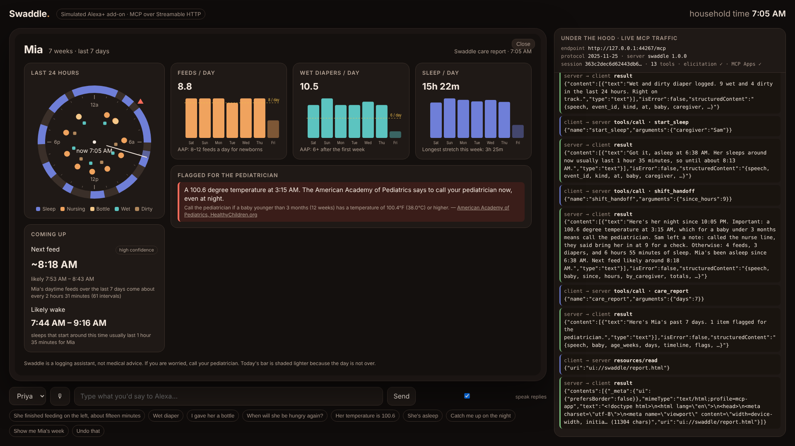

# Swaddle: hands-free baby care for Alexa+

**Alexa+ track · self-hosted MCP server · Streamable HTTP · protocol 2025-11-25**

It's 3:12 AM. A parent has a newborn in one arm and a bottle in the other. Pediatricians want every feed, diaper and fever tracked, and today that means a phone, one thumb, in the dark.

Swaddle is a baby-care service an Alexa+ household can talk to:

- **Log by talking:** feeds (breast side and duration, bottle amount), diapers, sleep, temperatures and notes for the other parent.
- **Ask what's next:** next feed and nap predictions **learned from this baby's own recent history**, weighted toward the same time of day.
- **Safety thresholds with sources:** temperatures are checked against American Academy of Pediatrics "when to call" guidance for the baby's age, and the source is cited every time.
- **Shift handoff:** "catch me up on the night" leads with what needs action (a flagged fever, a note from the nurse line), then the numbers.
- **On a screen:** the same tool renders an **MCP App**: a 24-hour clock of sleep, feeds and diapers, a week of trends against pediatric guidance, and flags with their sources.

> Demo video: `<YOUTUBE LINK>` · Simulated Alexa+ client: run the server and open http://localhost:8000/



## Why baby care

About 3.6 million babies were born in the US in 2024 ([CDC NCHS](https://www.cdc.gov/nchs/products/databriefs/db535.htm)). Newborns feed 8–12 times a day, and parents are asked to watch for 6+ wet diapers a day ([AAP, HealthyChildren.org](https://www.healthychildren.org/English/ages-stages/baby/breastfeeding/Pages/How-to-Tell-if-Baby-is-Getting-Enough-Milk.aspx)). A temperature of 100.4°F or more under 3 months means calling the pediatrician right away ([AAP](https://www.healthychildren.org/English/health-issues/conditions/fever/Pages/When-to-Call-the-Pediatrician.aspx)). It is the one time of life when a parent's hands are never free, which makes voice the only interface that works.

## Quick start (about 1 minute)

```bash
git clone https://github.com/ShermaineYap/Swaddle-AmazonDevHack.git && cd Swaddle-AmazonDevHack
python -m venv .venv && source .venv/bin/activate
pip install -e ".[dev]"
SWADDLE_DEMO_TIME=2026-10-23T03:12 SWADDLE_SEED_END=2026-10-23T02:57 python -m swaddle.server
```

- MCP endpoint: `http://localhost:8000/mcp` (Streamable HTTP)
- Simulated Alexa+ client: `http://localhost:8000/`. Type or click the suggestion chips, or use the mic in Chrome.
- The first run seeds 10 days of generated history for a demo baby, "Mia" (7 weeks old), so predictions have patterns to learn from. Set `SWADDLE_SEED=0` to start empty and use `setup_baby`.

Call it from any MCP host, for example the official Inspector:

```bash
npx @modelcontextprotocol/inspector --cli http://localhost:8000/mcp --transport http --method tools/list
npx @modelcontextprotocol/inspector --cli http://localhost:8000/mcp --transport http --method tools/call --tool-name predict_next
```

Run the tests (a real server process, a real MCP client, real Streamable HTTP, including elicitation):

```bash
pytest -q
```

## How it works

```
Caregiver voice ──► Alexa+ (LLM picks a tool from tools/list, reads `speech` aloud)
                        │  POST /mcp  (JSON-RPC, SSE responses, Mcp-Session-Id)
                        ▼
              Swaddle MCP server (swaddle/server.py)
              13 tools · typed outputSchema · annotations · elicitation · MCP App · resource
                        │
                        ▼
      Care engine: SQLite care log (store.py) · predictions (insights.py) · AAP thresholds (guidance.py)
```

### Where the required technology is used

| Requirement | Where |
|---|---|
| MCP server built on the official Python SDK (`mcp` 2.x `MCPServer`) | [`swaddle/server.py:40`](swaddle/server.py#L40) |
| Streamable HTTP transport at `/mcp` | [`swaddle/server.py:581`](swaddle/server.py#L581) (`streamable_http_app`) |
| Protocol 2025-11-25 handshake (`initialize`, `tools/list`, `tools/call`) from the client | [`web/index.html:176`](web/index.html#L176) |
| Elicitation: the server asks for a missing bottle amount mid-call | [`swaddle/server.py:197`](swaddle/server.py#L197); client side [`web/index.html:167`](web/index.html#L167) |
| MCP Apps (`io.modelcontextprotocol/ui`): `ui://swaddle/report.html` bound to `care_report` | [`swaddle/server.py:444`](swaddle/server.py#L444), [`swaddle/ui/report.html`](swaddle/ui/report.html); host side [`web/index.html:310`](web/index.html#L310) |
| Resource with the guidance and its sources | [`swaddle/server.py:543`](swaddle/server.py#L543) |

### Tools

| Tool | What it's for | Annotations |
|---|---|---|
| `log_feed` | "She finished on the left, 15 minutes" / "gave her a bottle" (asks for the amount via elicitation if it's missing) | write |
| `set_bottle_amount` | Fallback for hosts without elicitation: "it was 3 ounces" | write |
| `log_diaper` | wet / dirty / both, with a 24-hour count | write |
| `start_sleep` / `end_sleep` | "She's asleep" / "she woke up" | write |
| `log_temperature` | Checks the reading against AAP thresholds for the baby's age; `call_now` is said first | write |
| `add_note` | Notes for the other caregiver, read out at the next handoff | write |
| `get_last` | "When did she last eat? Which side?" | read-only |
| `predict_next` | Next feed and next sleep or wake | read-only |
| `shift_handoff` | "Catch me up on the night" | read-only |
| `care_report` | Multi-day report; MCP App on screens, one spoken line otherwise | read-only |
| `undo_last` | "Scratch that" | destructive |
| `setup_baby` | First-run profile | idempotent |

Every tool returns a short `speech` string in the text content (what a voice assistant reads aloud) plus structured content that matches a published `outputSchema`, which screens and other agents can use.

### Predictions

`predict_next_feed` ([`insights.py:108`](swaddle/insights.py#L108)) takes the last 7 days of feed-to-feed intervals and weights each one by:

- **time-of-day similarity:** a Gaussian kernel on circular hour distance (σ = 2.5 h), so a 3 AM question is answered from 3 AM behaviour;
- **recency:** a 3-day half-life.

It reports the weighted median and interquartile range as the ETA and the "likely between" window. Confidence comes from the effective sample size and the spread. Sleep predictions blend the baby's own awake windows with an age-based prior, and the baby's own data dominates as it accumulates ([`insights.py:146`](swaddle/insights.py#L146)).

### Safety

Swaddle never diagnoses. It compares logged facts with a small set of published thresholds ([`guidance.py`](swaddle/guidance.py)). When one is crossed it says so plainly, tells the caregiver to call their pediatrician, and cites the source. Count-based flags (wet diapers, feeds per day) only fire once there is a full day of logging, to avoid false alarms from missed logs.

## Simulated Alexa+ client

Hackathon entrants have no access to the Alexa+ MCP Toolkit or simulator, so `web/index.html` stands in for it. It is a small MCP client written without an SDK, so every message is visible in the "live MCP traffic" panel. It speaks protocol 2025-11-25 over Streamable HTTP (including SSE responses and server-to-client elicitation requests) and hosts MCP Apps in a sandboxed iframe. A rule-based router maps utterances to tools in place of Alexa+'s LLM, so the demo runs offline with no API keys. The speaker dropdown simulates Alexa+ voice ID, which is how Swaddle knows who did each feed.

## Deploy

- Docker: `docker build -t swaddle . && docker run -p 8000:8000 swaddle`
- Render free tier: `render.yaml` (New → Blueprint)
- Production Alexa+ would add OAuth 2.1 account linking (each household gets its own care log) and a managed database. The tool contracts would not change.

## Demo video

`video/make_video.py` rebuilds the submission video from scratch. It starts the server with a frozen demo clock, drives the client in Chromium, voices each line with Kokoro TTS, and assembles the result with ffmpeg. Everything on screen is the live server's real output.

## Limitations

- Demo household and history are generated (`swaddle/seed.py`). No real baby data is used.
- Single household per server instance. Multi-tenant account linking is future work.
- Not medical advice: Swaddle logs, predicts and points to your pediatrician.

## Built during the hackathon

All code in this repository was written during the Build, Ship, Shape submission window (October 2026). It is a new project, not an extension of an earlier one.

## License

MIT © 2026 Shermaine Yap Shi Min
